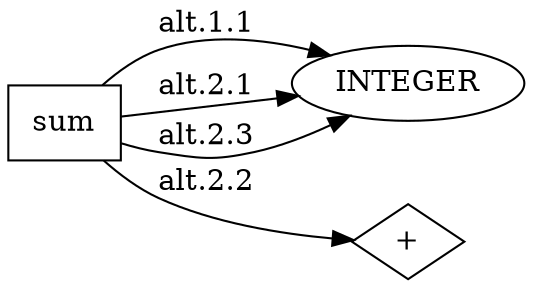

# cparsegen input, output, and usage reference

This is a reference to the **implemented behavior** on `main` at commit
`2f770442b82f456476f355710fbbd647381226cf`, not a proposed grammar standard.
cparsegen is a bounded parser generator written in Cwhip. It reads a grammar
file and writes parser source plus a DOT dependency graph. Its supported
source targets are **Cwhip** and **standalone ISO C99**. It does not compile
the generated source, evaluate the parsed language, or generate an application
compiler automatically.

cparsegen is the parser generator. SmallC (a C-subset demonstration) and the
bounded, non-object-oriented statement compiler are separate **demonstrations
of using cparsegen**, not a full-featured OOP compiler roadmap. **cwhip is the
separate full-featured OOP compiler project.** This reference covers committed behavior
only; it does not incorporate uncommitted demonstration extensions.

## Contents

- [Usage: build, generate, compile, and run](#usage-build-generate-compile-and-run)
- [Generator command-line contract](#generator-command-line-contract)
- [Grammar input format](#grammar-input-format)
- [Scanner and parser behavior](#scanner-and-parser-behavior)
- [Grammar validation and generator errors](#grammar-validation-and-generator-errors)
- [Generated files and layout](#generated-files-and-layout)
- [Generated parser CLI and diagnostics](#generated-parser-cli-and-diagnostics)
- [Tokens, trees, JSON, and locations](#tokens-trees-json-and-locations)
- [Embedding a Cwhip parser](#embedding-a-cwhip-parser)
- [Embedding a C parser](#embedding-a-c-parser)
- [Visitor dispatch and traversal](#visitor-dispatch-and-traversal)
- [Optional consumers and build targets](#optional-consumers-and-build-targets)
- [Troubleshooting and limits](#troubleshooting-and-limits)
- [Implementation and verification sources](#implementation-and-verification-sources)

## Usage: build, generate, compile, and run

All commands below start in the repository root and use default output
directories. The generator requires an installed Cwhip SDK **0.0.1**, including
its CMake integration and application-output-directory support. It does not
download or build that SDK. See [Building](BUILDING.md) for installation and
host prerequisites.

```sh
cmake -S . -B build
cmake --build build --target cparsegen
mkdir -p build/reference
```

CMake selects a nonempty `CWHIP_SDK` first, then registered top-level
`sdk_prefix` in `$XDG_CONFIG_HOME/cwhip/sdk.toml` (or
`$HOME/.config/cwhip/sdk.toml`), then normal package discovery such as
`CMAKE_PREFIX_PATH`. Legacy `settings.toml` is considered only if `sdk.toml`
is absent. An invalid explicitly selected SDK is an error, not a reason to
fall back. To override selection:

```sh
CWHIP_SDK=/absolute/path/to/cwhip-sdk cmake -S . -B build
```

`CWHIP_BIN_DIR` and `CWHIP_LIB_DIR` are CMake cache paths, defaulting to
repository-root `bin/` and `lib/`. Examples here assume the former default.
Put the selected SDK's `bin/` on `PATH` for direct `cwhip` commands.
Alternatively, `./scripts/setup` configures `build/` and opens a project
shell there; its optional argument is `debug` (default), `release`, or
`profile`. Commands in that shell need paths relative to `build/`, not the
root-relative paths used here.

### End-to-end Cwhip example: prefix versus complete input

The existing [shortest fixture](../tests/fixtures/shortest.cpg) is equivalent
to the following grammar (its comments and `@note` do not change parsing):

```text
sum : INTEGER | INTEGER "+" INTEGER ;
INTEGER = [0-9]+
```

Generate source and a graph, compile the source, and supply a **file**, not an
expression argument:

```sh
./bin/cparsegen tests/fixtures/shortest.cpg \
  build/reference/shortest.cw build/reference/shortest.dot
cwhip build/reference/shortest.cw -o build/reference/shortest
printf '123+456' > build/reference/input.txt
build/reference/shortest build/reference/input.txt
build/reference/shortest --complete build/reference/input.txt
```

The two parser invocations print, respectively:

```text
sum(INTEGER(123))
sum(INTEGER(123), @literal0(+), INTEGER(456))
```

Both succeed with exit status `0`. Default parsing chooses the shortest
successful **token prefix**; `--complete` requires every scanned token. The
scanner still checks the entire file in either mode.

### End-to-end C example: the same grammar, JSON output

```sh
./bin/cparsegen --target c tests/fixtures/shortest.cpg \
  build/reference/shortest.c build/reference/shortest-c.dot
cc -std=c99 -Wall -Wextra -Werror -pedantic \
  build/reference/shortest.c -o build/reference/shortest-c
build/reference/shortest-c --json build/reference/input.txt
```

Output is one JSON object followed by a newline:

```json
{"name":"sum","text":"","children":[{"name":"INTEGER","text":"123","children":[]},{"name":"@literal0","text":"+","children":[]},{"name":"INTEGER","text":"456","children":[]}]}
```

The generated C program needs only a C99 compiler and the standard library
to compile/run, not Cwhip, the SDK, or runtime templates. Generation itself
still needs cparsegen and its SDK. The Cwhip generated runner has no `--json`
mode; JSON in a Cwhip application is supplied by handwritten code.

### Whitespace, repetition, and a graph

The [words grammar](../examples/words.cpg) is a complete runnable example:

```text
words : IDENT ("," IDENT)* ;
IDENT = [A-Za-z_][A-Za-z0-9_]*
SPACE = [ \t\r\n]+
@skip SPACE;
```

```sh
./bin/cparsegen --target c examples/words.cpg \
  build/reference/words.c build/reference/words.dot
cc -std=c99 build/reference/words.c -o build/reference/words
printf 'alpha, beta_2, gamma' > build/reference/words.txt
build/reference/words --complete build/reference/words.txt
```

```text
words(IDENT(alpha), @literal0(,), IDENT(beta_2), @literal0(,), IDENT(gamma))
```

Whitespace is absent from the tree because of `@skip`, not because the
generator implicitly ignores whitespace in parsed input.

If Graphviz is installed, render a graph separately:

```sh
dot -Tsvg build/reference/shortest.dot -o build/reference/shortest.svg
```

Neither Graphviz nor a generated executable is run by cparsegen itself.

## Generator command-line contract

The supported target selections are:

```text
cparsegen GRAMMAR OUTPUT OUTPUT.dot
cparsegen --library GRAMMAR OUTPUT OUTPUT.dot
cparsegen --target c GRAMMAR OUTPUT OUTPUT.dot
```

Each form also accepts repeated `--include-path DIR:DIR...` options before
the positional paths, in any order relative to the target selection:

```sh
./bin/cparsegen --include-path grammars:vendor/grammars \
  --include-path /opt/project/grammars --target c \
  grammar/main.cpg build/parser.c build/grammar.dot
```

The list separator is a literal POSIX colon (`:`), not a comma. Search
directories are tried in list/option order. Relative directories are relative
to the generator's working directory. Empty components mean that working
directory: `:shared`, `shared:`, `shared::vendor`, and an entirely empty
argument `--include-path ""` all explicitly add it. Quote the shell argument
when a directory contains spaces. Colons cannot be escaped in this list.
These paths locate included grammars, not the main `GRAMMAR` argument.

| Selection | Parser source written | Embedded entry point |
| --- | --- | --- |
| No option | Cwhip, conventionally `parser.cw` | `start` block with file CLI |
| `--library` | Cwhip, conventionally `parser.cw` | None; include it from an application |
| `--target c` | Standalone C99, conventionally `parser.c` | `main`, excluded when compiling with `CPARSEGEN_NO_MAIN` |

All three positional paths are mandatory. Names/extensions are caller-chosen;
there is no automatic basename, extension detection, output directory,
default output file, stdin mode, or stdout-source mode. A path `-` is not a
documented stream selector. Create parent directories before generation.
Use distinct grammar/source/graph paths: the CLI does not validate path
collisions or protect existing output files from replacement.

Put options before the three paths. `--` ends option processing, allowing a
grammar filename beginning with `-`. There is no
generator `--help`, `--version`, `--target cwhip`, C++/Python target, combined
`--library --target c`, entry-rule option, or resource-limit option.

Successful generation returns `0` without a success message. Explicit usage
errors return `2` and print this line on stderr:

```text
usage: cparsegen [--library | --target c] [--include-path DIR:DIR...] [--] GRAMMAR OUTPUT OUTPUT.dot
```

Grammar/target validation errors return `1` on stderr, normally as
`GRAMMAR: line N: diagnostic`; some whole-model checks omit the line number.
Included-file errors name the resolved absolute file and original line,
followed by `included from PATH: line N` entries back to the main file.
The generator reads and validates the grammar and constructs both output
strings **before opening either output**. Invalid grammars do not create or
truncate outputs. Once validation succeeds, outputs are opened in write mode;
writing them is not transactional. An incomplete write reports
`PATH: incomplete write` and returns `1`. Grammar file open/read errors return
`1` with the input path and, for includes, the include site's location/context.
Output open/write exceptions still use the Cwhip system runtime's diagnostics.

## Grammar input format

### Declarations, names, and grammar trivia

Declarations may be interleaved, and references may precede declarations.
The first declared **parser rule**, not the first lexer rule, is the entry
rule. At least one parser rule and one lexer token declaration are required;
an `@quoted` declaration counts as a lexer token.

Identifiers use ASCII letters, digits, and `_`, with no leading digit.
Lexer names must begin with `A` through `Z`; parser-rule names must begin
with `a` through `z`. Names are case-sensitive. Naming-case conventions do not
force the rest of the name to be upper/lowercase.

Outside quoted literals, classes, and directive payloads, the grammar reader
skips whitespace/control bytes through ASCII space and comments:

```text
# line comment
// line comment
/* block comment, not nested */
```

Parser rules may span lines and include comments up to their terminating
`;`. Grammar-file comments/whitespace are not declarations of what to skip
in a generated parser's input.

### Lexer declarations

```text
INTEGER = [0-9]+
IDENT = LETTER (LETTER | DIGIT)*
NUMBER = ("+" | "-")? DIGIT+ ("." DIGIT+)? ([eE] ("+" | "-")? DIGIT+)?
LETTER = [A-Za-z_]
DIGIT = [0-9]
PAIR = [0-9]+[0-9]
SPACE = [ \t\r\n]+
```

A lexer declaration is a **single-line regular expression**, optionally ending
with `;`. All expression tokens, including group closers and the optional
semicolon, must be on the declaration name's line; do not put another
declaration on that line. Existing class-only declarations work unchanged.
Whitespace and grammar comments between atoms are trivia, not input bytes.
Write `" "` or `[ ]` to match a space.

| Form | Meaning |
| --- | --- |
| `[abc]`, `[a-z]` | One byte from a class or inclusive ascending range |
| `[^a-z]` | One non-NUL ASCII byte outside the class |
| `"text"` or `'text'` | Literal byte sequence (not a regex inside quotes) |
| `DIGIT` | Inline reference to a named `=` lexer expression, including a forward reference |
| `(a \| b)` | Group |
| `a?`, `a*`, `a+` | Zero-or-one, zero-or-more, one-or-more occurrences of an atom/group |
| `a b` | Concatenation, with or without intervening whitespace |
| `a \| b` | Alternation; every branch participates in longest-byte matching |

Precedence, highest first: atoms/groups, one postfix quantifier,
concatenation, alternation. Thus `"a" | "b" "c"+` means
`"a" | ("b" ("c"+))`. A quantifier after a quoted sequence repeats the whole
sequence: `"ab"+` matches `ab`, `abab`, etc. Bare names are references, not
literal spellings. All named rules remain scanner candidates, including
referenced helpers; put larger tokens before helpers to win equal-length
ties. References inline only the helper's pattern, not its token kind,
`@skip` behavior, or keyword remapping. Skipped helpers may be composed.
`@quoted` tokens and parser rules cannot be composed into lexer expressions.

Classes and lexer literals match bytes **1 through 127**, not Unicode code
points. Negation complements exactly that domain, so `[^a]` cannot consume
NUL or UTF-8 bytes. Classes must be nonempty and match at least one byte.
Class escapes are `\t`, `\r`, `\n`, `\\`, `\]`, `\[`, `\-`, and `\^`;
escaped range endpoints are allowed, e.g. `[\t-\r]`. An unescaped leading
`^` negates; elsewhere it is literal. After an endpoint, a `-` is a range
operator when another endpoint follows, otherwise it is a literal byte.
Use `\-` for an unambiguous literal hyphen. Descending ranges are errors.
Other regex metacharacters are ordinary bytes inside classes.

Quoted grammar literals decode only `\\`, `\"`, `\'`, `\n`, `\r`, and `\t`.
Unknown escapes, including `\0`, `\xNN`, and regex shorthands such as `\d`,
are errors. Raw LF is not allowed in a literal. Literal metacharacters must
be quoted or classed: `"|"`, `"*"`, `"("`, `[+]`, `[\]]`, etc. Outside
classes/quotes, backslash escapes are not supported. Comment markers inside
quotes/classes are literal, e.g. `"//"` or `[#]`.

There are no wildcard `.`, anchors, counted repetitions, lazy/possessive
quantifiers, lookaround, backreferences, captures, or Unicode classes. Empty
groups, alternatives, and literals are errors. Every named rule must be
nonnullable, including skipped/unused helpers. Nullable operands under any
quantifier (even `?`) and all direct/indirect reference cycles are rejected
with a source line before outputs are opened. Runtime matching uses a shared
Thompson NFA with deduplicated states, not recursive backtracking. Overlapping
alternatives are safe and need not be disjoint.

Generation limits are 128 group levels, 128 expanded expression/reference
edges on a path, and 4,096 total expanded NFA states across ordinary rules
(including accept/split states and each inlined reference occurrence). These
are diagnosed at generation time. Both scanners allow 100,000 visited NFA
states per input token boundary across all competing rules, with an explicit
resource-limit error, never a partial successful match. See
[lexer-expressions.cpg](../examples/lexer-expressions.cpg) for a runnable
composition example and [its commands](../examples/README.md#composable-lexer-expressions).

### Parser rules and EBNF

```text
entry : value "!" ;
value : INTEGER | INTEGER "+" INTEGER ;
empty : ;
```

| Syntax | Meaning |
| --- | --- |
| `TOKEN` | Reference to a named lexer token |
| `rule` | Reference to another parser rule |
| `"text"` or `'text'` | Literal terminal, with delimiters removed from its matching spelling |
| `a b` | Sequence |
| `a \| b` | Alternative candidates in source order |
| `(a b \| c)` | Group |
| `a?`, `a*`, `a+` | Optional, zero-or-more, one-or-more |
| `rule : ;` or an empty alternative | Empty sequence |

One postfix quantifier may follow an atom or group. Empty quoted terminals
are rejected: write an empty sequence instead. Grammar quoted terminals use
the same decoded escape vocabulary as lexer literals (`\\`, `\"`, `\'`,
`\n`, `\r`, `\t`); raw LF and unknown escapes are errors. This is distinct
from source-input escape handling enabled by `@quoted`, which preserves the
original source spelling.

Forward rule references and recursion are supported, including consuming
direct/indirect left recursion and cycles through nullable prefixes. A
nullable operand under any postfix quantifier, including `?`, is rejected as
`nullable repetition`.

There are no embedded actions, return types, semantic predicates,
precedence/associativity declarations, named captures, tree-rewrite
directives, or automatic expression folding. Encode precedence in separate
rules, as in the [calculator grammar](../examples/calculator/calculator.cpg).

### Left recursion

Both backends support left-recursive grammars without flattening rule nodes
or introducing helper-rule nodes. For example:

```text
expression : expression "+" INTEGER | INTEGER ;
INTEGER = [0-9]+
```

Complete parsing of `1+2+3` yields:

```text
expression(expression(expression(INTEGER(1)), @literal0(+), INTEGER(2)), @literal0(+), INTEGER(3))
```

Prefix parsing still returns `expression(INTEGER(1))`. Longer candidates
remain available to callers. Separate expression/term rules encode
precedence; no precedence is inferred from operator spellings. Ambiguous
grammars retain source-order choice, including at each nested recursive
call: `e : e e | DIGIT ;` prefers left nesting for three digits, whereas
`e : DIGIT | e e ;` prefers right nesting.

Supported forms include mutual/indirect cycles (`a : b "x" | INTEGER ;`
and `b : a "y" | INTEGER ;`), grouped recursion, nonnullable repeated
suffixes, nullable bases, and nullable prefixes such as
`e : empty e "+" INTEGER | INTEGER ;` with `empty : ;`.
Every cycle must consume tokens somewhere in its surrounding context.
Cycles with **both nullable prefixes and nullable suffixes** are rejected,
even in unreachable rules: for example `e : e | INTEGER ;`,
`e : empty e | INTEGER ;`, `e : e "x"? | INTEGER ;`, or the mutual
unit cycle `a : b ; b : a | INTEGER ;`. These can insert arbitrarily many
rule wrappers without consuming another token, so choosing a finite tree
would silently change derivation/order semantics. Remove the unit/nullable
cycle, or require a nonnullable prefix or suffix on every cycle.
Diagnostics identify the closing reference's source line and rule.
Purely consuming cycles with no terminating alternative are allowed but
cannot match; they terminate with a parse error within the usual budgets.

The implementation uses **span-bounded expansion**, not greedy suffix
folding or grammar substitution. After nullability analysis, each
nonnullable expression supplies a conservative lower bound of one token.
While matching a sequence, the matcher reserves the sum of those bounds
for its remaining children and temporarily reduces the current child's
ending-token ceiling. Consuming prefixes advance the starting index;
consuming suffixes reduce the ceiling. With zero-context cycles excluded,
recursive expansion is finite for a finite token stream. Only impossible
derivations are pruned; alternatives, result order, and AST construction
are unchanged. Non-left-recursive grammars retain their original matching
behavior and diagnostics.

This is still bounded exhaustive backtracking, **not packrat or a
linear-time left-recursion algorithm**. Even a single deterministic
left-recursive chain can retain quadratically many intermediate results;
ambiguous grammars can require exponential work. Recursive expansion counts
toward the existing depth/call/result budgets, including in prefix mode,
and C's arena budget also applies. Budget exhaustion is an explicit error,
never an incomplete tree or a silently chosen early candidate. Parse-error
positions in left-recursive grammars reflect the farthest explored
span-feasible position, not a guarantee of the most helpful offending token.

### Directives

Directive syntax is `@name payload;`. Except for `@include` and `@insert`, the reader
collects payload bytes up to the **first semicolon**, trims the surrounding
whitespace, and does not parse
the payload as a parser expression. Quotes/comments inside the payload do
not protect a semicolon. Payloads can cross lines. A directive must be a
declaration, not part of a parser-rule expression.

| Directive | Implemented effect and constraints |
| --- | --- |
| `@include "parts/tokens.cpg";` | Expand another grammar at this declaration position, once per resolved path; see below. Bare paths without whitespace and single-quoted paths are also accepted. |
| `@skip SPACE;` | Mark exactly one declared lexer token as discarded. A skipped token cannot be referenced by a parser rule. Multiple skip directives are allowed. |
| `@keywords IDENT;` | Designate one declared `=` lexer token for exact literal remapping. Only one such directive is allowed; the token cannot be quoted or skipped. Its name does not itself guarantee an identifier-shaped pattern. |
| `@reserved struct typedef;` | Add one or more identifier spellings that become `@reserved` when the designated keyword token wins. Requires `@keywords`; repeated directives accumulate spellings. |
| `@quoted CHAR single;` | Declare a new token for a single-quoted character spelling. Name must satisfy lexer naming/uniqueness checks; do not also declare it with `=`. |
| `@quoted STRING double;` | Declare a new token for a double-quoted string spelling, including the empty string `""`. |
| `@line_comment //;` | Register one nonempty marker, skipped through CR, LF, or EOF. CR/LF themselves remain for normal scanning. Repeated directives add markers. |
| `@block_comment /* */;` | Register opening and closing markers. Skip through the first closer; no nesting. An absent closer is a lexical error. Repeated directives add pairs. |
| `@note any opaque text;` | No generation effect. |
| `@insert c file_post { ... };` | Insert opaque target code at a validated file-scope boundary; see [Code insertion](#code-insertion). |

Except for `@skip`'s single trimmed token name, supported lexical directive
arguments are split on spaces, tabs, CR, and LF. Markers are **unquoted
spellings**, not strings: write `//`, not `"//"`. Empty markers or wrong
argument counts are invalid.

Quoted source tokens permit printable ASCII bytes, excluding an unescaped
matching delimiter. A single-quoted token must contain exactly one byte or
escape; a double-quoted token may contain zero or more. The escapes are
`\\`, `\"`, `\'`, `\n`, `\r`, `\t`, and `\0`. Raw control/non-ASCII bytes,
unknown escapes, missing closers, and multi-character character literals are
errors. **Quotes and escape spellings are preserved, not decoded.**

The Cwhip backend stores other directives as opaque declarations with no
generation effect; this is not support for an extension named by the
directive. The C backend explicitly rejects directives outside the table.

### Code insertion

```text
@insert c imports {
#include <limits.h>
};
@insert cwhip visitor_post {
class MyVisitor : GeneratedVisitor {
    int enter_token_WORD(AstNode node) { return VISIT_CONTINUE }
}
};
```

The exact syntax is **`@insert TARGET BOUNDARY { BODY };`**. Target and
boundary are case-sensitive, unquoted identifiers separated by whitespace
(space, tab, CR or LF); comments are not allowed in the header. Targets are
exactly `c` (standalone ISO C99) and `cwhip` (the default, including
`--library`). There is no wildcard/shared target, C++, or Python support.
Blocks for a different implemented target are validated but not emitted;
unknown targets or boundaries are errors even in unselected blocks.

Every boundary is **outside** generated classes, structures, functions, and
rule bodies. The following table describes exact placement, not execution
timing. `pre`/`post` do not register runtime callbacks.

| Boundary | Cwhip placement | C placement |
| --- | --- | --- |
| `file_pre` | Before the built-in `import system as Sys` | Before the generated banner and standard includes |
| `imports` | Immediately after the built-in import | Immediately after all built-in standard includes |
| `declarations` | After `imports`, before `LexToken` | After `imports`, before any generated typedef |
| `ast_pre` | After `LexToken`, before `AstNode` | After `Token`, before `typedef struct Node Node` and its definition |
| `ast_post` | Immediately after `AstNode` | Immediately after `struct Node`, before `Result` and the remaining shared types including `Context` |
| `scanner_pre` | After `ast_post`, before `ScanRange`/`ScanState`/`ScanRule`/`InputScanner` | After tables and visitor code, before runtime `report`/`fail`/`allocate` and scanner helpers |
| `scanner_post` | After `InputScanner` | After the complete internal `scan` function |
| `parser_pre` | After `scanner_post`, before `ParserExpr`/`ParserRuleDef`/`ParseResult`/`GeneratedParser` | After `scanner_post`, before result-building and match helpers |
| `parser_post` | After `GeneratedParser`, before `visitor_pre` | After `cpg_init`/`cpg_destroy`/`cpg_parse`, before the CLI's `#ifndef CPARSEGEN_NO_MAIN` |
| `visitor_pre` | After `parser_post`, before `GeneratedVisitor` | After immutable grammar tables, before `CpgVisit`/`CpgHook`/`CpgVisitor`, accessors and walking functions |
| `visitor_post` | After `GeneratedVisitor`, before the optional CLI `start` | After visitor functions, before `scanner_pre` |
| `file_post` | After the optional CLI `start`, or after `visitor_post` in library mode | After the CLI's closing `#endif` |

C's physical order is imports/declarations, AST/shared types, tables,
visitor, scanner, parser, CLI, footer. Cwhip's order is imports/declarations,
AST, scanner, parser, visitor, CLI, footer. The table does not imply a
cross-target component ordering. Inserted declarations must respect what is
already defined at their chosen seam; for example C `ast_post` can use
`Node` but not yet `Context`, while C `parser_post` can use the parser and
visitor APIs. Use prototypes or later seams for forward dependencies.

Within each target/boundary, blocks retain encounter order, including
depth-first grammar includes (and their once-only expansion). Different
boundaries always follow generated layout, regardless of their order in the
grammar. The shared validated model stores each block's target, boundary,
unchanged body, absolute source identity, one-based source line, and diagnostic
line ID; emitters consume these records, never reparse code.
All seams are emitted in both CLI and library workflows. C library consumers
still define `CPARSEGEN_NO_MAIN` before including the generated file; this
suppresses only the generated CLI, **not** insertion blocks. Cwhip `--library`
still omits only the generated `start`. To supply an entry point, use library
mode and put it in the consumer, not a block also compiled with the CLI.

**Delimiters and preservation.** Everything after the opening `{` and before
its matching `}` is copied byte-for-byte, including leading/trailing
whitespace, CRLF, comments, semicolons and escape spellings. Neither outer
brace nor terminating semicolon is emitted. Each emitted body gets one
additional LF before and after it to prevent accidental token/comment
concatenation with generated code. The final `;` may be separated from `}`
by ordinary grammar whitespace/comments. Empty blocks are permitted.

Collection is iterative and uses balanced braces, ordinary single/double
quoted literals with backslash escapes, `//` line comments (through CR/LF),
and non-nesting `/* ... */` comments. Braces/semicolons inside those literals
or comments do not delimit the block. There is no interpolation or
generator-level escape decoding. A literal `}` can be quoted/commented, or
balanced with an opening brace when it is actual code. Quotes cannot contain
raw CR/LF. EOF inside a block, quote or block comment and a missing final
`;` produce source-located diagnostics, including grammar include ancestry,
before outputs are opened or truncated.

Each body is limited to **1,048,576 bytes** and **256 simultaneous brace
levels including the outer delimiter**. NUL, backslash immediately followed
by CR or LF, and every `??` trigraph prefix are rejected everywhere in the
body, even in comments/quotes. This deliberately excludes C translation-phase
line splicing/trigraphs that could change delimiter recognition. No C
preprocessing, macro expansion, conditional-branch selection, C++ raw strings,
or target-language parsing occurs: preprocessor branches and macro bodies
must be lexically balanced as written, and includes remain literal target
code. Unsupported target constructs are the consumer compiler's concern.
Non-ASCII body bytes are preserved, not validated as target syntax. Grammar
syntax and the generated input scanner keep their existing ASCII contracts.

**Responsibilities and trust.** Treat grammars and included grammar files
containing insertions as source code from a trusted author. cparsegen copies
code; it does not compile or execute it during generation. Consumers compile
and may execute arbitrary injected code, including target include/import
dependencies and any initialization supported by that language. There is no
sandbox or semantic/safety validation. Authors own valid declarations,
dependencies, symbol collisions, linkage, memory/resource handling, and
compatibility with library and CLI builds. Use `declarations`/component seams
for public prototypes/types and C `static` helpers for private implementation;
there is no synthetic public/private section or generated-header split.
Do not modify generated APIs, reopen classes, or assume stable internal
symbols. All fragments must be complete file-scope declarations/directives.
There are no member-insertion seams, inline rule actions, automatic hooks,
or new parse semantics. AST and ordinary visitor APIs remain the application
integration model.

The [runnable two-target word counter](../examples/README.md#code-insertion)
uses injected helper declarations and a visitor with the ordinary parser.

### Grammar includes

```text
@include "parts/entry.cpg";
@include shared-tokens.cpg;
@include '/opt/project/grammar files/common.cpg';
```

`@include` requires exactly one nonempty filename followed by `;`. Single or
double quotes permit spaces and semicolons in filenames. The matching quote
cannot appear within that filename; backslashes are literal path bytes, not
escape sequences. Control bytes/newlines inside a filename, empty paths,
extra arguments, and missing terminators are errors. Comments are supported
around directives, not inside their path payloads.

An absolute path is used directly. A relative path is tried first against the
**including file's directory**, then against each `--include-path` directory
in order. Nested includes use their own including file's directory. The
working directory is not an implicit fallback (unless a search component
explicitly adds it). The first existing candidate wins; a directory,
unreadable file, or other non-regular candidate is an error, not a reason to
silently try a later search directory. Filesystem APIs resolve existing
symlinks to absolute paths; nested relative paths use that resolved directory.
There are no additional traversal restrictions or automatic extensions.

Expansion is depth-first at the directive's position. Included files may
interleave lexer declarations, parser rules, and directives, including further
includes. All declarations are collected into the same grammar before
reference resolution/validation, so lexer and parser forward references work
across files. Encounter order is the same as manually inlining the files;
the first encountered parser rule is the entry rule. `@include` cannot split
a lexer declaration or parser expression, and an included parser rule must
terminate within its own file. Other directive payloads remain opaque:
`@note @include missing.cpg;` does not load a file.
Likewise, `#include` or `include` text inside an `@insert` body is copied for
the target compiler, never expanded as a grammar file. Use `imports` for
native include/import text, not the grammar-level `@include`.

Each resolved absolute path is expanded **once per generator invocation**.
Repeated includes, normalized `.`/`..` paths, symlink aliases, and diamonds
reuse the first expansion, without repeating declarations or changing their
order. Hard links with different paths are distinct sources. Including a file
already active in the include stack is a cycle error, not a skipped include.
The generator allows at most 128 simultaneously active files (including the
main file) and 1,024 distinct files per invocation; exceeding either bound is
an explicit error. This prevents unbounded nesting and exponential expansion.

These semantics apply to default Cwhip, `--library`, and `--target c`.
Missing/unreadable files, malformed includes, cycles, included syntax/semantic
errors, and unsupported C-target directives all fail before either output
is created or truncated.

## Scanner and parser behavior

The generated scanner processes the entire input before parsing. At each
token boundary:

1. It checks line-comment markers in their declaration order, then
   block-comment pairs in their declaration order. These checks precede token
   competition; overlapping markers are not selected by longest match.
2. Otherwise, it matches all named lexer rules and collected literals.
   **Longest byte match wins.** Equal lengths keep the earlier named lexer
   rule; named rules beat literals on a tie. Literal ties follow collection
   order.
3. If the winning kind is the `@keywords` token, an exact grammar-literal
   spelling remaps it to that literal's kind. Reserved spellings then
   override this with `@reserved`, which no grammar reference can consume.
4. It records a token unless its winning rule is skipped, then advances.
   With no match it fails at that byte.

All possible expression paths participate before longest-match selection;
`PAIR = [0-9]+[0-9]` can consume `123`, and `("a" | "ab") "c"` can consume
`abc` regardless of alternative order. Ordinary `=` lexer rules
retain declaration order. The implementation appends `@quoted` tokens after
all ordinary lexer rules during directive processing, retaining quoted
directive order within that appended group. A malformed recognized quoted
token reports an error rather than falling back to another token match.
Comment markers inside a successfully scanned quoted token are ordinary
token text.

Without `@keywords`, `"if"` loses an equal-length tie to `IDENT = [a-z]+`,
even when the parser expects `"if"`. With `@keywords IDENT;`, `if` becomes
the literal token, while `iffy` stays `IDENT`. Remapping occurs only if
`IDENT` actually wins: an earlier equal-length named rule can prevent it.
Reserved words are tokenized, not immediately reported as lexical errors;
they normally cause a parser error.

Parsing enumerates candidate matches; it is **not PEG first-success choice**
and not a greedy, longest-parse algorithm. It retains longer candidates that
a caller's continuation needs. At the selected entry:

- Prefix parsing chooses the candidate ending at the earliest token index.
- Complete parsing considers only candidates ending at the end of the token
  list.
- Equal-ending candidates keep source order.

For example, `value : INTEGER | INTEGER "+" INTEGER ;` does not hide the
longer match needed by `entry : value "!" ;` on input `123+456!`.
Conversely, prefix parsing of `INTEGER "+" INTEGER | INTEGER` still selects
the short candidate even with the long alternative listed first.

Precedence, associativity, and ambiguity resolution beyond these rules are
the grammar/application's responsibility. All candidates are explored within
the budgets below; an early viable candidate does not guarantee success if
later exploration exhausts a budget.

## Grammar validation and generator errors

The shared reader resolves and validates the complete grammar before either
backend emits files. It reports the first problem, not a list of errors.

| Area | Rejected examples or conditions |
| --- | --- |
| Grammar scanning | Unterminated comments/classes/quoted literals/directives; unknown escapes in grammar literals |
| Declarations | Missing `=`/`:`, missing parser `;`, unsupported lexer/parser syntax, wrong name case |
| Required declarations | No lexer rule or no parser rule |
| Uniqueness/references | Duplicate lexer/parser names, unknown token/rule references, parser reference to skipped token |
| Character classes | Empty/non-ASCII/NUL classes, empty complements, unsupported escapes, descending ranges |
| Nullability/recursion | Empty-matching lexer rules, empty quoted terminals, nullable quantified operands, any lexer reference cycle, parser cycles with nullable context on both sides |
| Directives | Invalid arity/style/name/reference; duplicate `@keywords`; `@reserved` without `@keywords`; skipped keyword token |
| C target | Any directive outside the supported allowlist, even one accepted opaquely by Cwhip |

For example, this grammar:

```text
entry : MISSING ;
INTEGER = [0-9]+
```

reports `PATH: line 1: unknown lexer token MISSING` on stderr, exits `1`,
and creates neither output. A lowercase unresolved name is diagnosed as an
unknown parser rule. Line numbers are one-based grammar-source line numbers;
the reader does not retain full filename/column/span objects for declarations.

Validation is not a full target-language symbol checker: user-chosen names
can still collide with generated API names or target-language reserved words.
Generated-source compilation remains a necessary integration step.

## Generated files and layout

Each successful invocation writes exactly the **two files named by the
caller**. It does not generate a separate header, binary, library archive,
package, build script, AST JSON file, evaluator, or visitor implementation
containing application semantics.

| Artifact | Contents |
| --- | --- |
| Cwhip source | `Sys` import, scanner/token classes, `AstNode`, grammar-specific parser tables/objects, `GeneratedParser`, `GeneratedVisitor`, and optionally a runner `start` block |
| C source | Standard headers, grammar-specific immutable tables, embedded scanner/parser/arena implementation, node accessors, visitor types/functions, and conditional `main`/rendering/JSON helpers |
| DOT graph | Parser-rule boxes, named-lexer ellipses (including skipped tokens), literal diamonds, and edges for parser references/literals |

Literal kinds are deduplicated by spelling and numbered `@literal0`,
`@literal1`, etc., in first encounter order while collecting parser-rule
expressions in declaration/child order. They are not source byte offsets or
stable vocabulary IDs. Change the grammar and the numbering can change.

For the shortest fixture, the complete DOT output is:



Edges preserve repeated references; their `alt...` labels describe expression
child paths. The graph is a dependency view, not a lexer automaton, parse
trace, AST, or complete graphical encoding of quantifiers/precedence.
DOT is identical for both backends. Repeated generation from the same grammar
and mode is deterministic.

## Generated parser CLI and diagnostics

These are **generated parser** options, not generator options:

| Runner | Invocation | Successful stdout |
| --- | --- | --- |
| Cwhip | `parser INPUT` | Rendered shortest-prefix tree and newline |
| Cwhip | `parser --complete INPUT` | Rendered complete-input tree and newline |
| C | `parser INPUT` | Rendered shortest-prefix tree and newline |
| C | `parser --complete INPUT` | Rendered complete-input tree and newline |
| C | `parser --json INPUT` | Complete-input JSON tree and newline |
| C | `parser --help` | Usage/help text; exit `0` |

`INPUT` is a file path; neither runner accepts source text as its positional
argument or documents stdin streaming. C reads in binary mode; Cwhip uses
`Sys.File(path, "r").readAll()`. The two C flags cannot be combined.
The Cwhip runner has no help or JSON option. As in the generator, argument
recognition is positional; an unrecognized single argument is treated as a
file path, not necessarily diagnosed as an option error.

Parsing success returns `0`. On ordinary scan/parse failure, both rendered
runners return `1` and print a single diagnostic on **stdout**, with no tree:

```text
lex error at byte 2
parse error at token 1
```

These are zero-based byte/token indices, not line numbers. Lexical directives
add messages such as `unterminated block comment at byte N`,
`invalid quoted escape at byte N`, `unterminated quoted token at byte N`,
and `character literal must contain one byte or escape at byte N`.
Budget errors are explicit messages such as `parser resource limit exceeded`.

In C `--json` mode, scan/parse/resource failure instead returns `1` with
empty stdout and a stderr diagnostic:

```text
file:line:column: diagnostic
```

Locations are one-based and byte-oriented. LF increments the line and resets
the column to `1`; CR and tabs each advance one column. Thus CRLF has one
line break, and columns are not display-width or Unicode-character counts.
Parser error location is the token at the farthest attempted parser position,
or EOF if that index is beyond the token list. It is not an expected-token
set, and is not guaranteed to point at the first unconsumed token of a
successful prefix candidate.

Usage errors return `2`: the C runner writes usage on stderr, but the
Cwhip runner writes it on stdout. C file open/read failures return `1` on
stderr; the Cwhip runner delegates file exceptions to the SDK runtime.
C output flush/write failure reports `parser: output write failed` on stderr
and returns `1`; output might already be partial after an I/O failure.

## Tokens, trees, JSON, and locations

The output often called an AST here is a **syntax tree retaining grammar-rule
structure**, not a typed/normalized semantic representation.

| Item | Shape and meaning |
| --- | --- |
| Rule node | Rule name, empty text, ordered children; an empty rule has no children |
| Named terminal | Lexer token name, original matched text, no children |
| Literal terminal | `@literalN`, original matched spelling, no children |
| Groups/sequences/choices/repetitions | No extra wrapper node; their matched children flatten into the containing rule in source order |
| Skipped whitespace/comments | No tree nodes |

Punctuation is retained. Numbers are still strings; there is no automatic
numeric conversion, escape decoding, binding, type annotation, constant
folding, or evaluation. An empty rule is not distinguishable from a terminal
merely by child count; use its kind and grammar knowledge.

### Rendered text and JSON

`AstNode.render()` and the C runner use `name(child, child)` or
`TOKEN(raw text)`. Empty rules render `empty()`. Text is not escaped; this
format is for people, not an unambiguous interchange grammar.

C's generated `--json` serializer emits exactly these keys on **every** node:

```json
{"name":"IDENT","text":"alpha","children":[]}
```

Rule text is `""`, children are arrays in stored order, and terminal text
includes original quote/backslash spellings where applicable. C escapes
quotes/backslashes and encodes bytes outside printable ASCII as `\u00xx`.
There are no token arrays, source offsets, spans, IDs, semantic values, or
diagnostics embedded in this JSON schema.

The SmallC Cwhip frontend implements the same node schema in handwritten
code and uses complete-input parsing. This does not imply that every
generated Cwhip parser provides a JSON serializer. Similarly, C's JSON
printing helpers are excluded under `CPARSEGEN_NO_MAIN`; library applications
serialize their borrowed tree themselves if needed.

### In-memory token/node layouts

Generated Cwhip objects expose:

```text
LexToken: String kind, String text, int offset
AstNode:  String name, String text, list children
```

`LexToken.offset` is a zero-based starting input byte offset; token length
is available as `text.length`. There is no EOF token. `AstNode` itself has
**no source offset/span or token link**, even for terminals. Keep the scanner
token list if an application needs source locations; the example consumers
associate terminal order with token order and find a rule's first terminal.
An empty rule has no first-terminal location.

Generated C uses:

```c
typedef struct { const char *kind; size_t offset, length; } Token;
typedef struct Node Node;
struct Node {
    const char *name;
    size_t offset, length, count;
    Node **children;
};
```

`Context.tokens`/`token_count` expose scanned non-skipped tokens. Terminals'
offsets/lengths reference the caller's original bytes. Rule nodes have zero
offset/length, **not** a computed span, and `count` ordered child pointers.
Names point to generated string constants. No parent pointers or
application semantic fields are generated.

## Embedding a Cwhip parser

Generate `--library` source alongside an application that includes it:

```sh
mkdir -p build/reference-cwhip
./bin/cparsegen --library examples/words.cpg \
  build/reference-cwhip/parser.cw build/reference-cwhip/grammar.dot
cp examples/visitor/words.cw build/reference-cwhip/words.cw
cwhip build/reference-cwhip/words.cw -o build/reference-cwhip/words
build/reference-cwhip/words 'alpha, beta, gamma'
```

This real consumer prints `names=3`. Unlike the generated file runner, this
handwritten example takes source text as a command-line argument.

The generated scanner/parser protocol is:

| API/state | Contract |
| --- | --- |
| `InputScanner(String input)` | Construct with source text |
| `scanner.scan()` | Return `true` on complete scanning, `false` on failure; resets tokens/error state on each call |
| `scanner.tokens` | Ordered `LexToken` objects; inspect only as a complete token stream after scan succeeds |
| `scanner.problem`, `scanner.errorOffset` | Error text and zero-based byte offset; offset resets to `-1` before scanning |
| `GeneratedParser(scanner.tokens)` | Construct parser at `position = 0` |
| `parser.parseAll()` | Parse first rule from current position, requiring the match to end at `tokens.length`; return `AstNode` or null |
| `parser.parse_RULE()` | Generated for every parser rule; shortest-prefix parse from current position; return node or null |
| `parser.position` | Updated to the selected candidate's ending token index only on success |
| `parser.problem`, `parser.errorPosition` | Error text and farthest attempted token index; parser selection resets error/step state |

There is no generic `parse()` method or named-rule complete-input wrapper.
For words, the generated prefix method is `parse_words()`. `parseAll()` does
not silently rewind a parser already advanced by another call: create a new
parser or explicitly reset `position = 0` to start over.

Minimal complete-input use inside a handwritten `start` block:

```cwhip
InputScanner scanner("alpha, beta")
if (!scanner.scan()) {
    Sys.StandardIO().writeErrorLine(scanner.problem)
    Sys.Process().exit(1)
}
GeneratedParser parser(scanner.tokens)
AstNode root = parser.parseAll()
if (root == null) {
    Sys.StandardIO().writeErrorLine(parser.problem)
    Sys.Process().exit(1)
}
print(format("{}\n", root.render()))
```

The containing file must `include "parser.cw"`; generated source already
imports `system as Sys`. Library scanning/parsing does not print diagnostics
or exit the process; applications check the returned result and state.
For located parser errors, map `errorPosition` to that token's `offset`,
or input length at EOF. Resource-failure locations are approximate.

Tree methods are `kind()`, `lexeme()`, `childCount()`, `childAt(index)`, and
`render()`. Public `name`, `text`, and `children` fields remain available.
`childAt` requires an in-range index; Cwhip list bounds failures propagate.
Strings, lists, and nodes use managed references, not a C arena or explicit
`cpg_destroy`. Keep needed references alive. Treat scanner tokens and trees
as read-only during passes even though public fields can be mutated.

## Embedding a C parser

Generate with `--target c`, define `CPARSEGEN_NO_MAIN`, and include the
generated source from **one** translation unit. Do not also compile that
source separately into the same executable. There is no separate generated
header or namespace scheme for linking multiple generated parsers together.

First generate the words parser:

```sh
mkdir -p build/reference-c
./bin/cparsegen --target c examples/words.cpg \
  build/reference-c/parser.c build/reference-c/grammar.dot
```

The following is a complete handwritten consumer of the generated words
parser; save it as `build/reference-c/consumer.c` beside `parser.c`:

```c
#define CPARSEGEN_NO_MAIN
#include "parser.c"

int main(void) {
    const unsigned char input[] = "alpha, beta";
    Context parser;
    cpg_init(&parser, input, sizeof(input) - 1, "<memory>");
    const Node *root = cpg_parse(&parser, 1);
    if (!root) {
        fprintf(stderr, "%s:byte %zu: %s\n",
                parser.path, parser.error_offset, parser.problem);
        cpg_destroy(&parser);
        return 1;
    }
    printf("%s: %zu children\n",
           cpg_node_kind(root), cpg_child_count(root));
    cpg_destroy(&parser);
    return 0;
}
```

Compile the consumer, not both source files:

```sh
cc -std=c99 -Wall -Wextra -Werror -pedantic \
  build/reference-c/consumer.c -o build/reference-c/consumer
build/reference-c/consumer
```

The consumer prints `words: 3 children`: two identifiers and the comma.

| API | Contract |
| --- | --- |
| `void cpg_init(Context *, const unsigned char *, size_t, const char *)` | Initialize a fresh context with borrowed source bytes/length and diagnostic path; sets quiet library behavior |
| `const Node *cpg_parse(Context *, int complete)` | Scan and parse first rule from token zero; nonzero `complete` requires all tokens, zero selects shortest prefix |
| `void cpg_destroy(Context *)` | Free arena data on success or failure; invalidates all token/node/child pointers; safe to call twice |
| `const char *cpg_node_kind(const Node *)` | NUL-terminated kind string |
| `size_t cpg_child_count(const Node *)` | Stored child count |
| `const Node *cpg_child_at(const Node *, size_t)` | Borrowed child, or NULL for an out-of-range index |
| `const unsigned char *cpg_node_text(const Context *, const Node *)` | Borrowed source slice, **not a NUL-terminated string** |
| `size_t cpg_node_text_length(const Node *)` | Slice length; zero for rule nodes |

Accessors require non-NULL, live nodes. Use `fwrite`/`memcmp` or another
length-bounded operation on text, not `%s`. Input need not be NUL-terminated,
but its pointer must be non-NULL even when length is zero.

The default library lifecycle is silent: parse failure returns NULL with
`Context.problem` and zero-based `error_offset`, without printing or exiting
the host process. `problem` is the base diagnostic (`"parse error"` or
`"lex error"`), not the rendered CLI's complete `... at token/byte N` string.
`error_position` holds the parser token index. Allocation/resource failures
are caught at the parse boundary and also return NULL; application visitor
callbacks do not run inside that internal failure boundary.

The context borrows both input and path; keep them alive, and input unchanged,
through parsing and all tree use. `cpg_destroy` does not free them or visitor
user data. Do not free individual nodes, copy a live context, or parse
concurrently on the same context. Destroy/reinitialize before a fresh parse
to reset the cumulative allocation budget. C does not expose a public
per-rule prefix API or a consumed-prefix cursor analogous to Cwhip's
`parser.position`.

For a runnable visitor consumer with no manual source creation:

```sh
cmake --build build --target visitor-c
./bin/visitor-c 'alpha, beta, gamma'
```

## Visitor dispatch and traversal

Both backends generate **read-only traversal interfaces**, not application
semantics. Parsing does not call them automatically, transfer ownership, or
provide mutation/replacement results. See [Application integration](VISITORS.md)
for full working consumers and compiler-pass guidance.

Hooks are generated for each parser rule, each non-skipped named token, and
each collected literal:

| Node kind | Hook suffix |
| --- | --- |
| `words` | `rule_words` |
| `IDENT` | `token_IDENT` |
| `@literal0` | `literal_0` |

Each suffix gets `on_`, `enter_`, and `leave_` hooks. Literal hook numbers,
like literal kinds, change when collection order changes.

| Operation | C | Cwhip |
| --- | --- | --- |
| Interface | Zero-initialized `CpgVisitor` callback table | Subclass `GeneratedVisitor` |
| Callback | `CpgVisit (*CpgHook)(const Node *, void *)` | Method returning `int`, taking `AstNode` |
| Single-node dispatch | `cpg_dispatch(root, &visitor, user)` | `visitor.dispatch(root)` |
| Depth-first walk | `cpg_walk(root, &visitor, user)` | `visitor.walk(root)` |
| Generic dispatch | `on_node` | `onNode(node)` |
| Generic traversal | `enter`, `leave` | `enter(node)`, `leave(node)` |
| Kind-specific example | `enter_token_IDENT` | `enter_token_IDENT(AstNode node)` |

A specific hook **replaces** its generic hook; they are not both called.
Unset C hooks fall back to generic callbacks, then to continue. Unoverridden
Cwhip methods delegate to the corresponding generic method. Unknown/custom
node kinds also use generic hooks. C passes the same caller-owned `void *`
to every callback; Cwhip subclasses keep state in application fields.

Dispatch selects one `on_*` hook and does **not** traverse children or call
enter/leave. The application can dispatch chosen children itself. Walking
calls enter, then children in stored order, then leave; it never calls
`on_*` hooks. A syntax DFS visits both branches of an `if`, so it is not
program execution. Use manual dispatch for evaluation/short-circuiting.

| Result | C | Cwhip | Effect |
| --- | --- | --- | --- |
| `0` | `CPG_CONTINUE` | `VISIT_CONTINUE` | Descend/finish normally |
| `1` | `CPG_SKIP` | `VISIT_SKIP` | From enter: skip children, still call leave |
| `2` | `CPG_STOP` | `VISIT_STOP` | Stop intentionally and propagate stop |
| `-1` | `CPG_ERROR` | `VISIT_ERROR` | Abort and propagate application failure |

A successful enter-skip completes as continue if leave returns continue.
Leave-skip and unknown integer results become error. Dispatch returns any
of the four valid statuses unchanged; skip does not imply traversal there.
Null nodes, or a NULL C visitor table, return error without callbacks.

Stop/error prevents remaining siblings and **does not unwind leave hooks**
for already-entered ancestors. Cwhip exceptions also propagate without
guaranteed leave calls. Keep resource cleanup/scope restoration outside the
walker. The application supplies its own diagnostic for visitor errors and
must distinguish a successful stop from an error. Visitors have no hidden
permanent stopped state; later calls are independent.

### Legacy Cwhip visitor

Cwhip also emits `void visit(AstNode)` and no-op `pre_RULE`/`post_RULE`
methods for every parser rule. This older visitor visits rule nodes
recursively in source order, invoking pre/post hooks; it ignores terminal
nodes and has no skip/stop/error return protocol. It is separate from
`dispatch`/`walk`; prefer those controlled APIs for new consumers. There is
no corresponding legacy `visit` API in generated C.

## Optional consumers and build targets

These targets are **not** the generator's automatic output and are not built
by the default generator target. With the default `build/` and `bin/`:

| Target | Generated inputs to the app | Executable / application output |
| --- | --- | --- |
| `calculator` | `build/calculator/parser.cw`, `grammar.dot` | `bin/calculator`: evaluated numeric results; interactive variables/commands in handwritten Cwhip |
| `smallc` | `build/smallc/parser.cw`, `grammar.dot` | `bin/smallc-ast`: complete-input JSON; optional handwritten `--check` semantic pass |
| `calculator-c` | `build/calculator-c/parser.c`, `grammar.dot` | `bin/calculator-c`: syntax tree/JSON, **not** calculator evaluation |
| `smallc-c` | `build/smallc-c/parser.c`, `grammar.dot` | `bin/smallc-c`: syntax tree/JSON, **no** SmallC semantic checker |
| `visitor-c` | `build/visitor-c/parser.c`, `grammar.dot` | `bin/visitor-c`: handwritten name counter/policy demo |
| `expression-compiler` | `build/expression-compiler/parser.c`, `grammar.dot` | `bin/expression-compiler`: handwritten visitor emits C source |
| `statement-compiler` | `build/statement-compiler/parser.c`, `grammar.dot` | `bin/statement-compiler`: handwritten semantic/code-generation demo emits C source |

The Cwhip example build also copies its handwritten `.cw` app beside the
generated parser for inclusion. CMake compiles C consumers with a host C99
compiler, with strict warnings-as-errors on GCC/Clang. All executable names
honor `CWHIP_BIN_DIR`; directories shown above are relative to the selected
CMake build directory. Installing the project installs `cparsegen` to `bin`,
not these optional consumers.

Typical application invocations:

```sh
cmake --build build --target calculator smallc expression-compiler statement-compiler
./bin/calculator -e '(2 + 3) * 4'
./bin/smallc-ast examples/smallc/valid/functions.c
./bin/smallc-ast --check examples/smallc/valid/functions.c
./bin/expression-compiler '(2 + 3) * 4' > build/expression-compiler/program.c
cc -std=c99 build/expression-compiler/program.c -o build/expression-compiler/program
build/expression-compiler/program
./bin/statement-compiler examples/compiler/statements/basic.stmt \
  > build/statement-compiler/program.c
cc -std=c99 build/statement-compiler/program.c -o build/statement-compiler/program
build/statement-compiler/program
```

The calculator and compiled expression program each print `20`; the compiled
statement sample prints `20`, `56`, and `28` on separate lines. The compiler
executables themselves print **C source**, not those runtime results.

SmallC is a C-subset syntax/checker demonstration, not a complete C compiler,
bytecode generator, or VM. `--check` belongs to its handwritten Cwhip
frontend; successful checking preserves the JSON syntax tree and failed
checking prints a located stderr diagnostic with no tree. The statement
demonstration is limited to variables, control flow, definite assignment,
`int`/`bool` typed functions, and checked int32 arithmetic in its own
grammar/visitor/runtime code; it has no classes, objects, or inheritance, and
none of this is a built-in cparsegen language feature.

Use the dedicated guides for application-specific language/checking limits:
[Examples](../examples/README.md), [SmallC](../examples/smallc/README.md),
[expression compiler](../examples/compiler/README.md), and
[statement compiler](../examples/compiler/STATEMENTS.md).

## Troubleshooting and limits

| Symptom | Current explanation / usage remedy |
| --- | --- |
| CMake cannot find Cwhip | Select the whole installed SDK prefix, not its `bin/` or CMake-package subdirectory; see [Building](BUILDING.md). |
| Output path fails | Create parent directories, use writable distinct paths, and check runtime I/O diagnostics. |
| `unsupported lexer expression syntax` | Keep the expression on one declaration line; use classes, quoted literals, named references, groups, alternation, and one postfix quantifier per atom. Quote literal metacharacters. |
| `unsupported parser-expression syntax` | Check a missing `;`, mixed declarations, embedded directives/actions, or unsupported punctuation. |
| Literal keyword never matches | A named token won an equal-length tie; use `@keywords` on the intended identifier token if keyword remapping is wanted. |
| Spaces cause `lex error` | Grammar whitespace does not skip source whitespace; declare and skip an input token. |
| Trailing text is accepted | Prefix mode is the default; use `--complete`, C `--json`, Cwhip `parseAll()`, or C `cpg_parse(..., 1)`. |
| A suffix causes a lexical error despite prefix mode | The scanner validates the entire file before selecting a parse. |
| `left recursion` | A cycle can repeat without consuming tokens. Remove the unit/nullable cycle or require a nonnullable prefix or suffix on every cycle; consuming left recursion is supported. |
| `nullable repetition` | Quantified operands must be nonnullable, including under `?`; rewrite the optional/repeated expression. |
| `cannot find included grammar` | Check the including file's directory and the ordered `--include-path DIR:DIR...` list. An empty path component explicitly adds the working directory. |
| Other directive appears accepted in Cwhip | Unknown payloads are opaque, not executed. C rejects unknown directives; `@include`, `@insert`, and the listed lexical directives are implemented by both targets. |
| Tree text is not a number or decoded string | Terminal values are source spellings; conversion belongs to a handwritten consumer. |
| Syntax success but application rejects input | Application visitors/checkers implement their own semantics; parse success does not imply semantic validity. |

The parser uses bounded backtracking; the scanner uses a bounded iterative NFA:

| Budget | Cwhip | Standalone C |
| --- | --- | --- |
| Scanner NFA state visits per token boundary | 100,000 | 100,000 |
| Parser expression matcher calls per selection/parse | 100,000 | 100,000 |
| Nested parser-rule depth | 256 | 256 |
| Results per intermediate result set | 4,096 | 4,096 |
| Lexer expanded NFA states (generation) | 4,096 | 4,096 |
| Expanded lexer AST/reference depth (generation) | 128 | 128 |
| Scanner matching recursion | None | None |
| Source length | No separate explicit size cap | 1 MiB, inclusive |
| Cumulative arena data | Managed by Cwhip runtime | 64 MiB; allocation bookkeeping/input buffer are separate |

The C library also enforces its input-size limit. All explicit budget
exhaustion is failure, not silent truncation or partial success; actual
allocation failure is also an error. Result arrays, tokens, and unselected
candidate trees consume C arena data, so a small final tree does not imply a
small parse budget. C's additional limits can reject inputs Cwhip accepts.
Resource-error locations are approximate farthest-parser positions (or EOF
before parsing), not precise explanations of where exhaustion originated.

Limits are hardcoded, not CLI settings. There is no promised linear parsing
time, incremental/streaming parsing, automatic recovery, full source spans,
general regex engine, semantic
action execution, or C++/Python emitter. Walkers/serializers recurse over
trees and do not provide a separate configurable traversal budget.

The older [architecture document](ARCHITECTURE.md) includes proposed
`SourceSpan`, normalization, source-stack, and future-backend interfaces.
Those proposal sections are not the implemented input/output contract.
The direct-left-recursive [expression grammar](../examples/expression.cpg)
is now runnable with either backend.

## Implementation and verification sources

This reference was checked against these implementation surfaces rather than
inferring features from the architecture proposal:

| Contract | Source and regression coverage |
| --- | --- |
| Generator arguments, outputs, validation ordering | [main.cw](../src/main.cw), [generator tests](../tests/test_generator.py), [C backend tests](../tests/test_c_backend.py) |
| Grammar syntax, directives, validation | [grammar.cw](../src/grammar.cw), [grammar conformance tests](../tests/test_grammar_conformance.py) |
| Include expansion, search paths, source diagnostics | [grammar.cw](../src/grammar.cw), [include tests](../tests/test_includes.py) |
| Left-recursive recognition, AST/order preservation, rejection boundary and budgets | [left-recursion tests](../tests/test_left_recursion.py), [grammar.cw](../src/grammar.cw), both runtimes |
| Cwhip source/API, tree structure, DOT | [emitter.cw](../src/emitter.cw), [generator tests](../tests/test_generator.py) |
| C source, runtime/API, JSON, budgets | [c_emitter.cw](../src/c_emitter.cw), [c_runtime.cw](../src/c_runtime.cw), [C backend tests](../tests/test_c_backend.py) |
| Visitor behavior and library failure handling | [visitor tests](../tests/test_visitors.py), [consumer fixtures](../tests/fixtures/visitor), [integration guide](VISITORS.md) |
| Optional build layout and SDK selection | [CMakeLists.txt](../CMakeLists.txt), [Building](BUILDING.md), [SDK-discovery tests](../tests/test_sdk_discovery.py) |
| Application-only behavior | [calculator](../examples/calculator/calculator.cw), [SmallC frontend](../examples/smallc/smallc.cw), [compiler examples](../examples/compiler) and their dedicated tests |

After building the generator, the narrowly scoped core contract suite is:

```sh
PYTHONPATH=tests python3 -m unittest \
  test_generator test_grammar_conformance test_left_recursion test_c_backend test_visitors
```

It generates/compiles real Cwhip and C parsers, checks successful and failed
input, compares backend behavior/DOT, and exercises library/visitor contracts.
For repository-wide tests and isolated SDK environment setup, see
[Building](BUILDING.md#run-tests).
